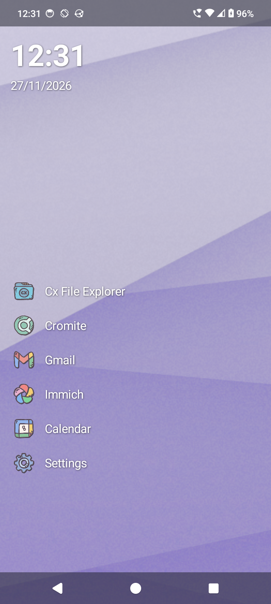
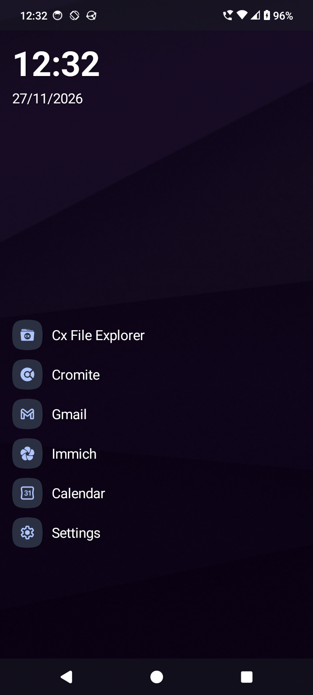
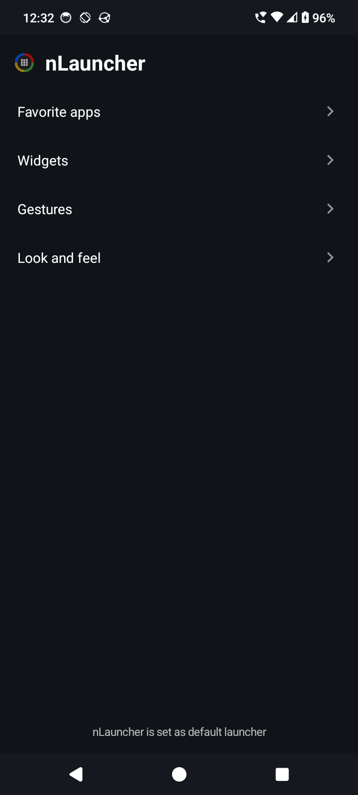

# nLauncher

nLauncher is a simple launcher based on its namesake, [mLauncher](https://github.com/CodeWorksCreativeHub/mLauncher).

<table>
    <tr>
        <td align="center"></td>
        <td align="center"></td>
        <td align="center"></td>
    </tr>
</table>

<sub>Icons are [kendi icons](https://play.google.com/store/apps/details?id=com.flawedkoncepts.kendi) and [lawnicons](https://github.com/LawnchairLauncher/lawnicons)</sub>

## Features

* Simple home screen with rearrangeable fav apps and widgets
* Gestures, basic theme customization
* Support for icon packs
* Search sorts by recently opened apps
* As lightweight as possible

## Improvements mLauncher.

* Consistent and minimal UI
* Search screen opens instantly by loading apps eagerly
* Intuitive and representative reordering UI for fav apps and widgets
* A much cleaner codebase with less random features

## TODO

* Support for adding custom intents (PWAs)
* Renaming apps
* Add more widgets and add configuration for them
* Onboarding UI

## Developing

```sh
git clone --depth 1 https://github.com/SollyBunny/nLauncher && cd nLauncher
./gradlew :app:installDebug # If you have a connected phone in debug mode, otherwise
./gradlew :app:assembleDebug
```

Useful commands

```sh
./gradlew :app:ktlintFormat
./gradlew :app:lint
```
